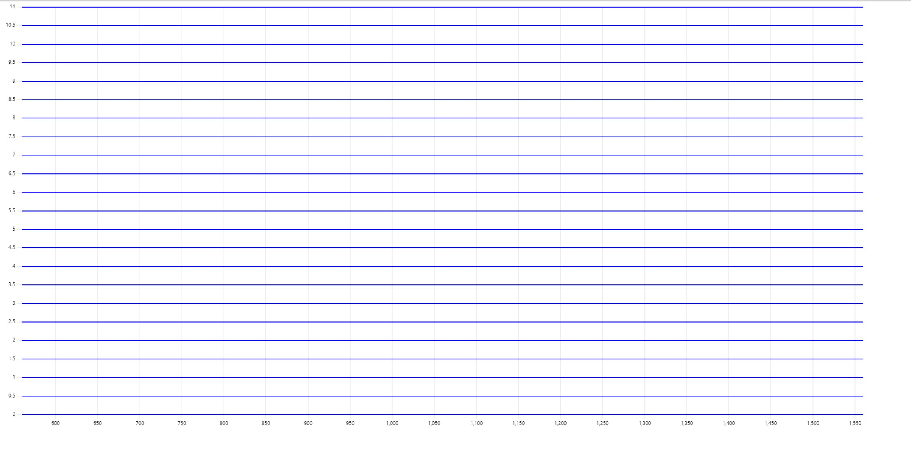
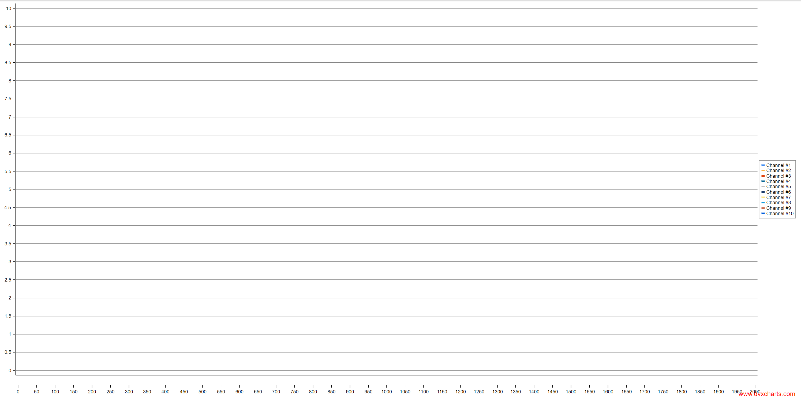
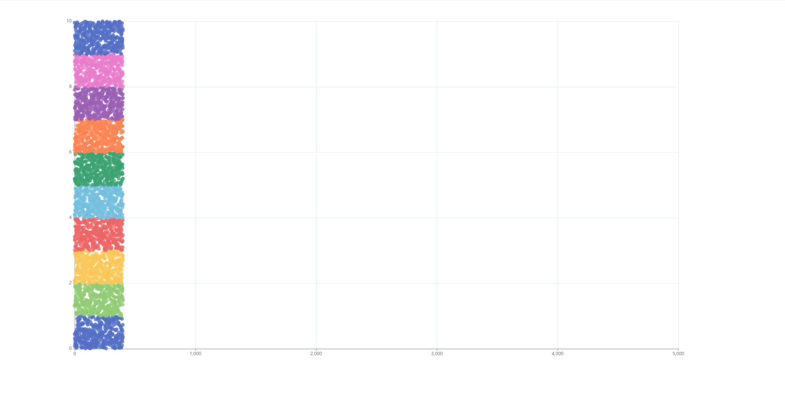

## uPlot real-time visualization error

Real-time tests bug out after ~5 seconds, resulting in all graphs showing flat lines.
Afterwards, FPS will be recorded to be much better than when the graphs are properly visible.
To workaround this issue, this particular solutions real-time tests are limited to 5 seconds.

## dvxCharts scatter visualization error

When trying to visualize more than 1000 scatter points, this solution results in completely empty chart.

## Apache ECharts scatter visualization error

When trying to visualize more than 5000 scatter points, this library does some strange async data loading animation, and eventually discards 90% of the data.

